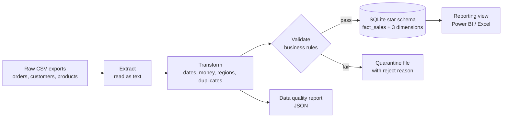
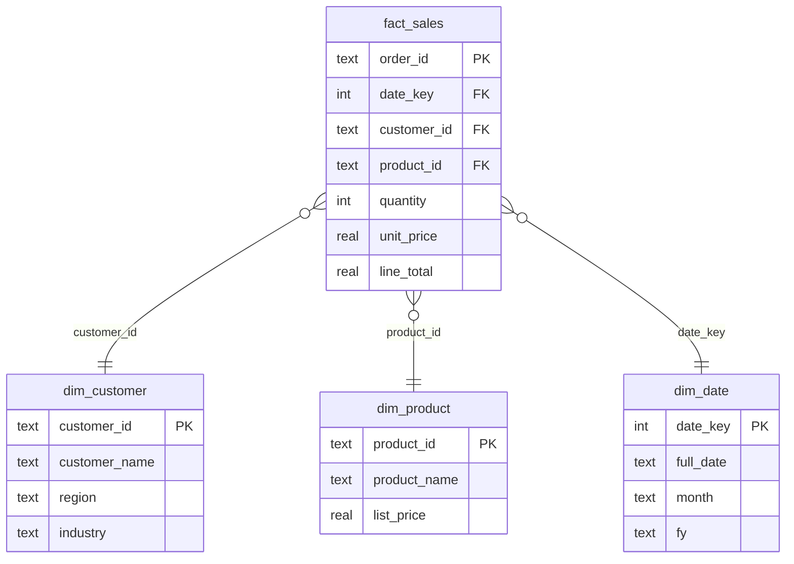

# Sales Data Pipeline (ETL to Star Schema)


**Tools:** Python (pandas) · SQL (SQLite) · pytest · GitHub Actions

A small, production-style ETL pipeline. It takes messy CSV exports from different business systems, cleans and validates them, quarantines bad rows with a clear reason, and loads the good data into a **star schema** that Power BI or Excel can report from directly.

> **Data note:** the raw files are **simulated** by `src/make_raw_data.py`, with real-world problems added on purpose. No real company data is used.

## The problem
Sales data from different systems rarely lines up. The raw files here contain the problems I see in real business data:

| Problem in raw data | Example | How the pipeline handles it |
|---|---|---|
| Duplicate export rows | same order twice | removed before loading |
| Mixed date formats | `2025-03-07`, `07/03/2025`, `07-Mar-2025` | parsed to one date (Australian day-first) |
| Impossible dates | `31/02/2025` | quarantined |
| Money stored as text | `$1,234.50` | converted to a number |
| Region spelt many ways | `WA`, `W.A.`, `Western Australia`, ` wa ` | standardised to `WA` |
| Stray spaces, mixed case | `  Customer 001 Pty Ltd `, `mining` | trimmed, title case |
| Missing or unknown IDs | blank customer, product `P999` | quarantined |
| Impossible values | negative quantity | quarantined |

## Pipeline



## Results from one run

| Measure | Value |
|---|---:|
| Raw order rows | 1,543 |
| Duplicates removed | 43 |
| Clean rows loaded | 1,437 |
| Rows quarantined | 63 |
| Pass rate | 95.8% |

Quarantined rows by reason: invalid date 20 · missing customer 19 · unknown product 13 · negative quantity 11. Every row is accounted for: clean + quarantined = raw − duplicates, and a test checks this on every run.

## Star schema



The schema also creates `vw_monthly_region_sales`, a ready-made view of monthly revenue by region for dashboards.

## Testing and automation
- `tests/test_pipeline.py` has unit tests for date, money and region cleaning, plus an end-to-end test that builds the raw data, runs the full pipeline and checks the warehouse: row counts reconcile, no orphan customer keys, no non-positive quantities.
- **GitHub Actions** runs all tests on every push (badge above).

## How to run

```bash
pip install -r requirements.txt
python src/make_raw_data.py   # creates messy files in data/raw/
python src/pipeline.py        # cleans, validates, loads data/warehouse.db
pytest -q                     # runs all tests
```

Outputs: `data/warehouse.db` (SQLite), `data/processed/clean_orders.csv`, `data/processed/quarantine_orders.csv`, `data/processed/data_quality_report.json`.

## Project structure

```
sales-data-pipeline/
├── .github/workflows/ci.yml   # runs tests automatically
├── src/
│   ├── make_raw_data.py       # simulated messy source files
│   └── pipeline.py            # extract, transform, validate, load, report
├── sql/
│   └── schema.sql             # star schema + reporting view
├── tests/
│   └── test_pipeline.py
└── requirements.txt
```

## Skills shown
ETL design · data validation and quarantine · data quality reporting · dimensional modelling (star schema) · SQL DDL and views · automated testing with pytest · CI with GitHub Actions

---
*Author: [Ashish Bhuva](https://github.com/ashishbhuva) · Data Analyst · Perth, WA*
